<div align="center">


<br/>

<a href="https://github.com/APZXCORE/NotchAura/releases/download/Release/NotchAura.exe"></a>

<br/><br/>


<br/><br/>

<b>No install. No account. No ads. No telemetry.</b><br/>
<sub>Native C# on the .NET Framework that already ships with Windows. No Electron, no browser engine.</sub>

<br/><br/>

<a href="#-preview">Preview</a> · <a href="#-features">Features</a> · <a href="#-the-scenes">Wallpapers</a> · <a href="#-shortcuts">Shortcuts</a> · <a href="#-faq">FAQ</a> · <a href="https://github.com/APZXCORE/NotchAura/releases">Releases</a>

<br/><br/>

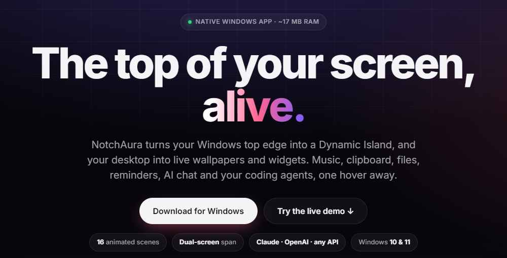

</div>


## 👁️ Preview

<div align="center">

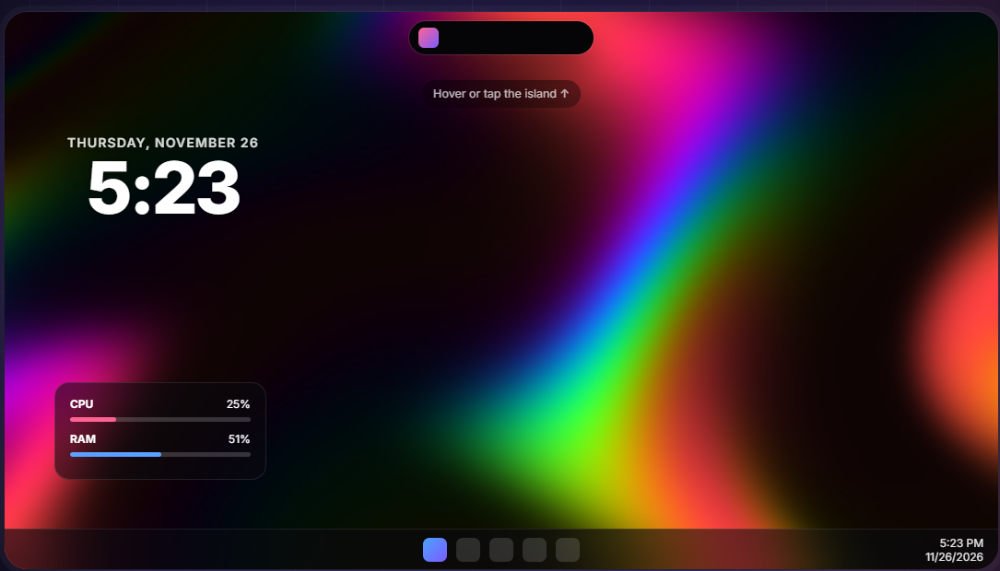

<sub>The island up top, a live wallpaper, clock and stats widgets, and the dock along the bottom.</sub>

<br/><br/>

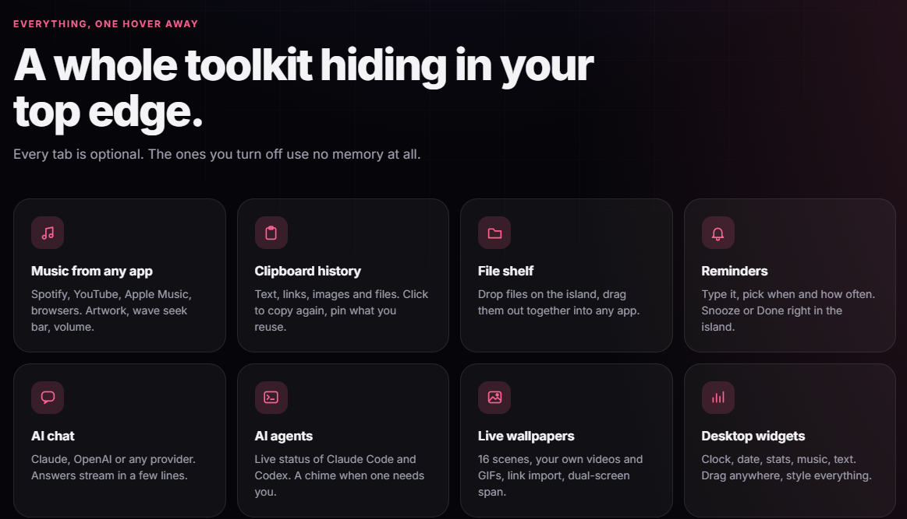

</div>


## ⚡ Get started

1. **[Download `NotchAura.exe`](https://github.com/APZXCORE/NotchAura/releases/download/Release/NotchAura.exe)** and run it. Nothing to install.
2. **Hover the top of your screen.** The island opens.
3. **Right-click the tray icon** for Settings.

> [!NOTE]
> The app isn't code-signed yet, so Windows SmartScreen may warn you. Click **More info → Run anyway**.


## ✦ Features

<table>
<tr>
<td width="50%" valign="top">

### 🏝️ The Island
Hover to open. Island or Notch shape. Black, **Glass** (real frosted blur), Graphite, Midnight and Frost themes, any accent color.

### 🎵 Music
Now playing from any app, with artwork, play/pause/skip, a wavy seek bar, volume and synced lyrics.

### 📋 Clipboard & Shelf
Clipboard history for text, links, images and files, with pins. Drop files on the island and drag them out anywhere.

### 🤖 AI Chat & Agents
Chat with Claude, OpenAI or any compatible provider, streamed right in the island. Keys are encrypted by Windows. Live status for Claude Code and Codex CLI.

### ⏱️ Focus
Timer and Pomodoro in the closed island, reminders that chime, to-dos and notes.

</td>
<td width="50%" valign="top">

### 🌌 The Scenes
24 original animated scenes, or your own videos, GIFs and images. Span, match or mix across monitors. Pauses over fullscreen apps and on battery.

### 🧩 Desktop Widgets
14 kinds: clocks, calendar, countdown, stats, network, disk, music, battery, weather, quotes and text. Any font, color and size.

### 🚀 Dock & Launcher
A floating dock or full-width bar that can replace the Windows taskbar. Launcher with apps, math, timers, notes and web search.

### 📱 Phone Remote
Scan one QR code and your phone becomes a trackpad, keyboard, media remote and live screen viewer. No app needed, stays on your Wi-Fi.

### 🎛️ Quick Controls
Volume, brightness, mic mute, night light, screenshot, color picker, keep awake and lock.

</td>
</tr>
</table>


## 🌌 The Scenes

<div align="center">

<b>24 original scenes, drawn live behind your icons.</b> These are real frames rendered by the app.

<br/><br/>

<table>
<tr>
<td align="center">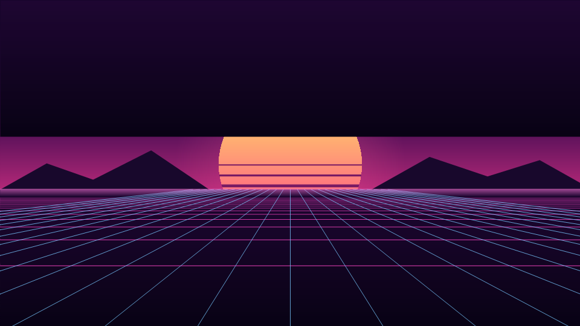<br/><sub><b>Synthwave</b></sub></td>
<td align="center">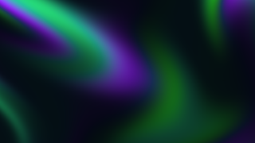<br/><sub><b>Aurora</b></sub></td>
<td align="center">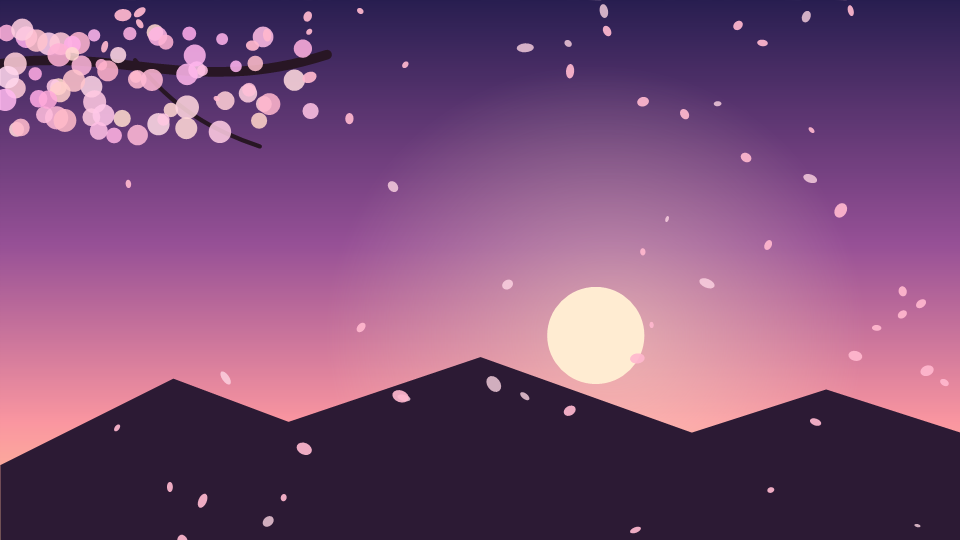<br/><sub><b>Sakura</b></sub></td>
</tr>
<tr>
<td align="center">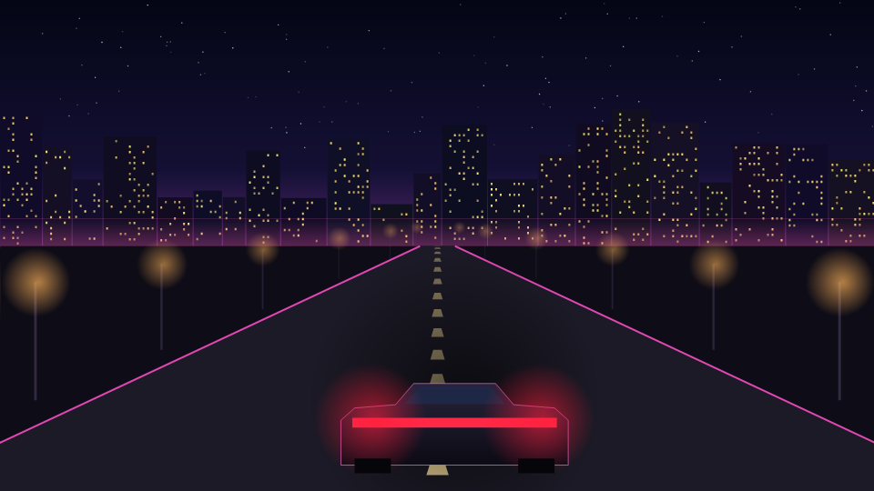<br/><sub><b>Night Drive</b></sub></td>
<td align="center">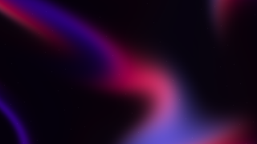<br/><sub><b>Nebula</b></sub></td>
<td align="center">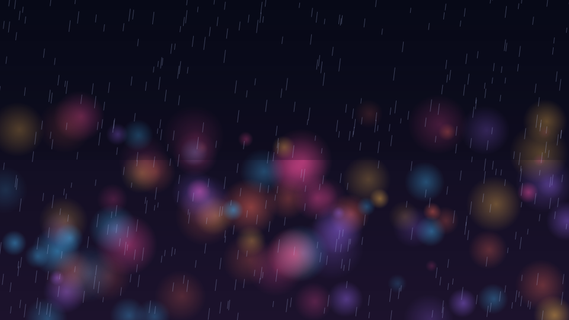<br/><sub><b>Rainy Night</b></sub></td>
</tr>
<tr>
<td align="center">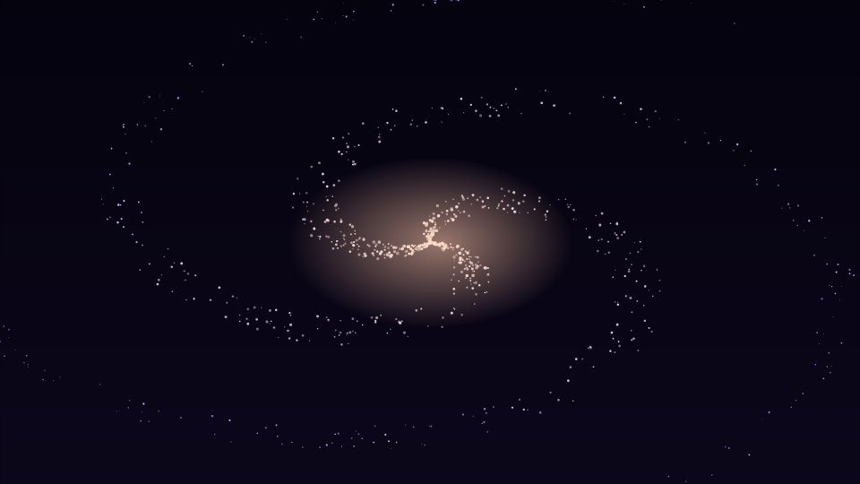<br/><sub><b>Galaxy</b></sub></td>
<td align="center">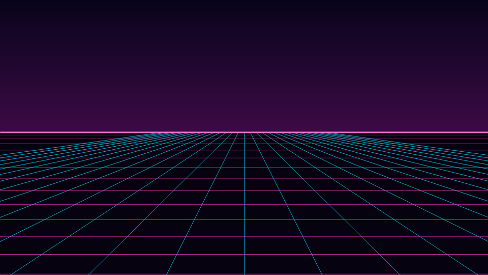<br/><sub><b>Neon Grid</b></sub></td>
<td align="center">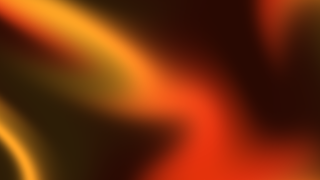<br/><sub><b>Ember</b></sub></td>
</tr>
</table>

<sub>Plus Liquid, Starfield, Fireflies, Snow, Matrix, Lava, Plasma, Ocean, Sunset, Mono, Bokeh, Waves, Clouds, Forest and Candy. Or use your own videos, GIFs and images.</sub>

<br/><br/>

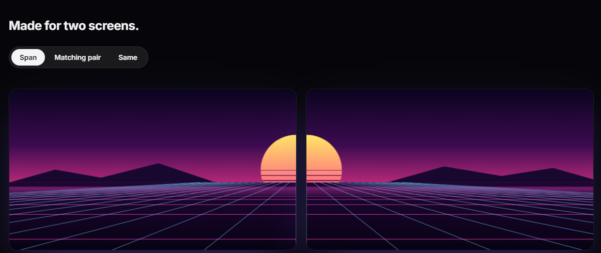

<sub><b>Made for two screens.</b> Span one scene across monitors, use a matching pair, or pick a different one for each.</sub>

</div>


## ⌨️ Shortcuts

| Shortcut | Action |
|:--|:--|
| <kbd>Ctrl</kbd> + <kbd>Alt</kbd> + <kbd>Space</kbd> | Launcher |
| <kbd>Ctrl</kbd> + <kbd>Alt</kbd> + <kbd>V</kbd> | Clipboard |
| <kbd>Ctrl</kbd> + <kbd>Alt</kbd> + <kbd>N</kbd> | Notes |
| <kbd>Ctrl</kbd> + <kbd>Alt</kbd> + <kbd>T</kbd> | Timer |
| <kbd>Ctrl</kbd> + <kbd>Alt</kbd> + <kbd>M</kbd> | Mute every mic |


## 🪶 Light on any PC

| | Memory |
|:--|:--|
| Island | **~17 MB** |
| Settings open | **~25 MB** |
| Live wallpaper | **~24 MB** |

Older PC? **Settings → Performance → Low-end** halves animation work and caps the wallpaper at 12 fps. **Auto** already picks it on weak PCs.


## 🔒 Your data

- Everything stays on your PC in `%APPDATA%\NotchAura`.
- No account, no ads, no telemetry.
- AI keys are encrypted by Windows (DPAPI).
- Online extras (weather, lyrics, AI chat, phone remote) only run if you turn them on.


## ❓ FAQ

<details>
<summary><b>Is it really free?</b></summary>
<br/>
Yes. Free forever, no ads, no account.
</details>

<details>
<summary><b>Windows says it's unsafe. Why?</b></summary>
<br/>
NotchAura isn't code-signed yet, so SmartScreen doesn't recognise it. Click <b>More info → Run anyway</b>. You can check the file against the SHA-256 below.
</details>

<details>
<summary><b>How do I start it with Windows?</b></summary>
<br/>
Settings → Island → <b>Start with Windows</b>.
</details>

<details>
<summary><b>Will it break my taskbar?</b></summary>
<br/>
No. Replacing the taskbar is optional, and the Windows taskbar comes back when you turn the dock off, quit, or if NotchAura crashes.
</details>

<details>
<summary><b>What if it crashes?</b></summary>
<br/>
It reopens by itself. After three crashes in a row it starts in safe mode. You can back up and restore everything from Settings → About.
</details>

<details>
<summary><b>How do I uninstall it?</b></summary>
<br/>
Quit it from the tray and delete <code>NotchAura.exe</code>. To remove your settings too, delete <code>%APPDATA%\NotchAura</code>.
</details>


## 🔐 Checksum

```
b857f4867f73d79202ba6ba1d1dfce4ab3a4a36e75b438af35d64c4f09e36d68  NotchAura.exe
```

<div align="center">

<br/>

<a href="https://github.com/APZXCORE/NotchAura/releases/download/Release/NotchAura.exe"></a>

<br/><br/>

<sub>Made by <a href="https://github.com/APZXCORE">APZX</a> · AGHABuilds · Not affiliated with Apple</sub>


</div>
